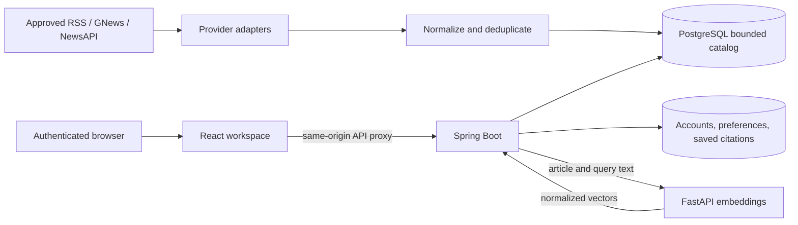

# PulseAI architecture

The existing application remains a React/Vite frontend, a Spring Boot modular monolith, and PostgreSQL owned by Flyway. FastAPI provides normalized 384-dimensional Sentence Transformers embeddings. The backend includes pgvector indexing and cosine search, but the local PostgreSQL 18 installation lacks the `vector` extension; the semantic route therefore reports its keyword fallback until pgvector is installed. No additional database or queue was introduced.

## Browser and API boundary

Vite proxies `/api` to the local backend; Nginx provides the same route in Compose. API base `/api/v1` stays consistent across environments. Typed Axios services provide 15-second deadlines, cancellation, structured errors, and one retry following a single-flight refresh. Access JWTs stay in memory. A rotating HttpOnly SameSite Strict cookie restores the browser session. Account data is server-authoritative; only UI theme choices stay in browser storage.

`AuthProvider` restores identity before protected routes render. `LibraryProvider` retrieves bounded saved citations and serializes repeated toggles for one article. `PulseProvider` keeps Lens context, Copilot state, and session-only conversations across workspace routes. React renders untrusted metadata as text; no publisher HTML is injected.

## Authentication and authorization

BCrypt cost 12, validated registration, normalized unique emails, HS256 issuer/expiry checks, and a session ID claim provide account authentication. PostgreSQL stores only SHA-256 hashes of random refresh credentials. Rotation uses a row lock. Seven-day fixed session expiry and deletion on logout make JWT revocation immediate through the session validator. Max 20 sessions per account. Public catalog reads are allowed; `/users/me/**` and `/assistant/**` require a valid bearer; ingestion requires ROLE_ADMIN. Unknown routes are denied.

Auth writes check the browser Origin against explicit allowed origins and reject cross-site Fetch Metadata. Cookies use Secure in the production profile; local HTTP disables it explicitly. See [security decisions and production gaps](docs/architecture/security.md).

## Catalog and lifecycle

Provider adapters return a shared metadata contract. XML parsing disables DTDs and external entities. The shared HTTP client bounds connection/request/whole-call time, response bytes, and rate-limit cooldown. Canonical URLs have a database unique constraint. Dynamic JPA specifications apply optional filters without ambiguous null PostgreSQL parameters; pagination is 1-100 rows, ordered by publication timestamp then ID.

Default article retention is 48 hours from publication with a 2,000-row cap. Cleanup also removes expired sessions and history older than 30 days. V4 changes the saved-article foreign key to ON DELETE SET NULL and backfills a minimal citation before enabling its non-null constraints. V5 preserves original article URLs separately from canonical deduplication URLs. V6 prepares optional pgvector storage when the extension is installed. Archived saves lose image/excerpt access but keep attribution and the original link. V1-V4 remain immutable.

Ingestion status is one overwritten row, not an indefinitely growing run log. Last successful refresh advances only for a configured non-empty fetch with no provider failures. Counts and timestamps describe retrieval, not publisher freshness or complete coverage.

## Intelligence boundaries

Current capabilities are deliberately inspectable: explicit category recommendations, latest-24-hour reading digests, 12-hour category count comparisons, and consented opening distributions. Related coverage requires two shared significant headline words among the latest 100 articles; the UI calls these candidates, never verified events or perspectives.

Copilot returns `catalog-search`, `publisher-excerpt`, `related-coverage`, or `unavailable`, with actual article metadata and source links. Page context prepares a future assistant interface, while optional article ID drives contextual excerpt/related retrieval now. No LLM is called. Questions, conversations, and responses are not persisted. Pulse Lens shows available evidence and compact future sections.

Semantic retrieval code and FastAPI embeddings are implemented. On this machine, pgvector activation is still pending because PostgreSQL 18 lacks the extension files; the API and UI label keyword fallback accurately. Evaluated classification/entity extraction, event membership, claim-supported RAG, and ML recommendations remain planned. Their datasets, licenses, model versions, retention, consent, and evaluations must precede product claims. See [roadmap](ROADMAP.md) and [API](docs/api/backend-api.md).
